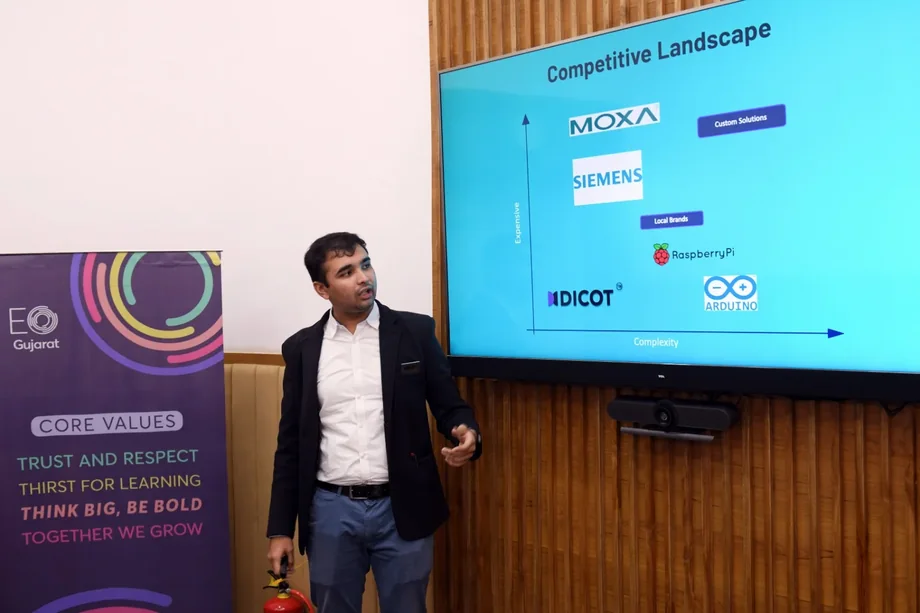
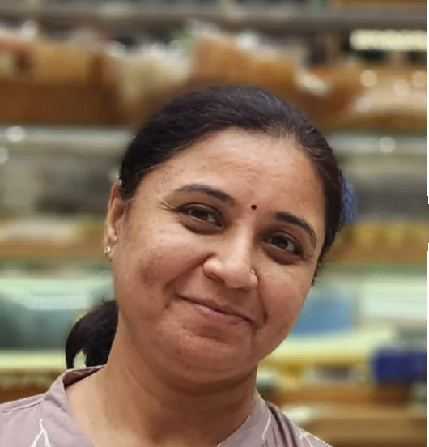
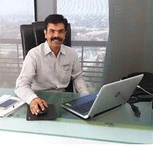
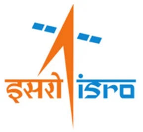
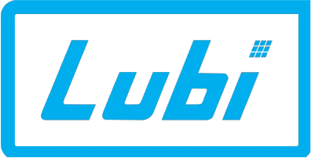
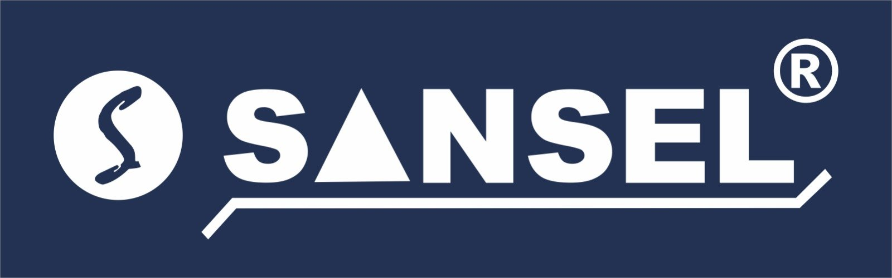

<!-- Markdown mirror of https://dicot.tech/about/. The HTML page remains the source of truth. -->
About Dicot

# Industrial software from Ahmedabad, for the world.

Dicot Innovations builds SCADA, IIoT and data-acquisition software for manufacturers. We started in 2022 with a simple observation: the plants that need data most are often the ones least able to afford a six-month integration project.

**800+**customers

**1,000+**deployments

**4,000+**device protocols

**50–100 ms**cloud update latency

Our story

## Built by people who commission plants.

Dicot was founded in Ahmedabad in 2022 by a small team with background in industrial automation. The first product, Vision C, was a reaction to what we saw on shop floors: capable machines, no usable history, and reports assembled by hand at the end of every shift.

Today the suite covers a mini-SCADA, an enterprise SCADA and a hosted cloud platform, used by more than 800 customers across 1,000+ deployments. The core team is six people, backed by directors and mentors from the automation industry.

We are recognised under Startup India, incubated at i-Hub (a Gujarat Government enterprise), supported by the Wadhwani Foundation and part of the Make in India initiative.

### What we optimise for

-   **Time to first data.** A product should be useful before the project plan is approved.
-   **Support that answers.** Production does not wait for a ticket queue.
-   **Software a plant can afford.** Pricing that matches the size of the problem.

### Registered office

A-805, Siddhi Vinayak Towers, Off S. G. Road, B/H DCP Office, Makarba, Ahmedabad, Gujarat 380051, India

Recognition

## Supported by the ecosystem.

Team

## The people behind the product.

The team that builds the software, backed by directors from the automation industry.

### Leadership

**Nandan Shukla**Chief Executive Officer

**Darshana Shukla**Director

### Board & mentors

**Dharren Savla**Director, Deep Industries Ltd.

**Niket Gorakhia**Director, Micon Automation

Customers

## Brands using Dicot software.

A selection of the manufacturers and institutions running our products.

Customer stories

## In their words.

> Dicot's IIoT software offers unmatched compatibility. Their data acquisition software is ideal for logging and remote monitoring, making them a top choice for manufacturing clients seeking reliable SCADA alternatives.

**Raj Kanabar**CEO, Radical TechArt

> Vision C is a game-changer. As a mini-SCADA, it is quick to set up and drives digitalisation forward. Our customers consistently praise its effectiveness as a modern SCADA India solution.

**Mayank Dantwala**CEO, Control Equipments & Marketing Co.

> Dicot's SCADA software is intuitive and stable. The prompt support ensures seamless remote monitoring and data logging, which is critical for our industrial operations and Industry 4.0 initiatives.

**Amit Prajapati**Maintenance Head, Electrotherm India Ltd.

## Come see the software.

A demo is the fastest way to judge whether we fit your plant. Bring your tag list.

[Book a demo](/contact/) [Talk to a dealer](/contact/#channel-partners)

---

Generated 2026-11-20 from https://dicot.tech/about/. Questions: sales@dicot.tech
