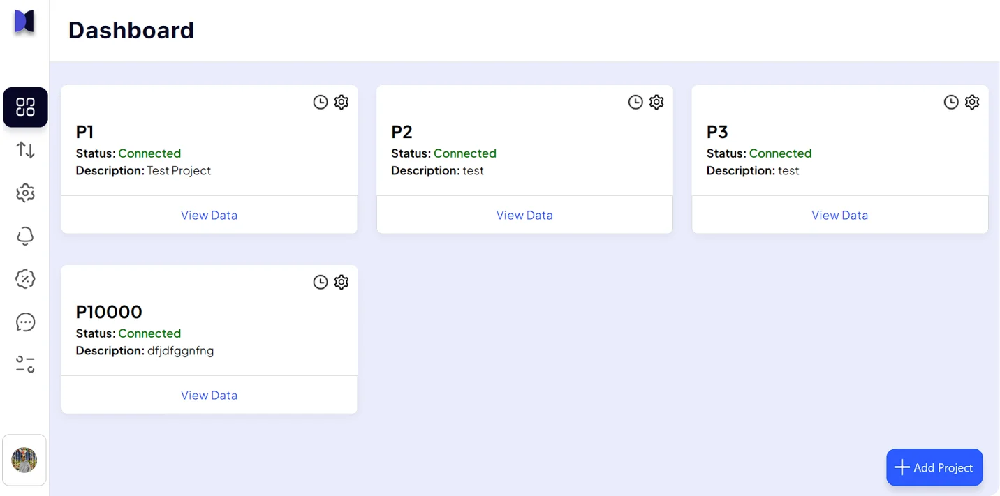

<!-- Markdown mirror of https://dicot.tech/. The HTML page remains the source of truth. -->
# SCADA and IIoT software, _built in India_ for the world.

Connect the shop floor to the top floor with Vision C, Vision S and Vision Web. One suite for data logging, remote monitoring and regulated manufacturing — deployed in 1,000+ plants across twelve industries.

[Book a demo](/contact/) [Explore the suite](/products/)

800+ customers 1,000+ deployments 4,000+ device protocols

Recognised & supported by

The layer between

## From a sensor on a machine to a decision on a phone.

Dicot makes the software layer between industrial equipment and the people who run it: collect data, keep it safe, show it clearly and raise the alarm when something drifts.

**800+** customers

**1,000+**deployments

**4,000+**device protocols

**50–100 ms**cloud update latency

Product index

## One architecture. Every size of plant.

[Compare all products](/products/)

[01

### Vision C

Mini-SCADA & data logger

Shop-floor SCADA that installs in minutes, not months.

Up to 100Modbus TCP/IP, RTU, BCD, AIBUS

](/products/vision-c/)[02

### Vision Web

Cloud SCADA & IIoT platform

Your plant on any screen, with alarms where your team already is.

Up to 20,000 per projectHTTP, MQTT

](/products/vision-web/)[03

### Vision S

Enterprise SCADA

Full SCADA for regulated, high-tag-count plants.

Up to 60,0004,000+, OPC UA and DA

](/products/vision-s/)[04

### Vision S Lite

Lightweight enterprise SCADA In development

The Vision S platform, sized for cost-sensitive plants.

Vision S platformReduced set vs Vision S

](/products/vision-s-lite/)[05

### VGraphic

Cloud report generator

Turn plant files into branded PDF reports from anywhere.

None, cloud-basedExcel, CSV, SQL, DAT

](/products/vgraphic/)

The data path

## One path from PLC to PDF.

Each product does one job in the same chain. Start at the machine, add plant-wide visibility, then put the evidence in front of the person who needs it.

1.  01 / Collect
    
    ### Vision C
    
    Reads Modbus TCP/IP, RTU, BCD and AIBUS from one machine or line. Up to 100 tags, logged locally.
    
2.  02 / Run the plant
    
    ### Vision S
    
    Enterprise SCADA for multi-line plants: 4,000+ protocols, OPC UA/DA and 21 CFR-ready audit trails.
    
3.  03 / Reach people
    
    ### Vision Web
    
    Hosted cloud SCADA with 50–100 ms updates and alarms by SMS, email, WhatsApp and Telegram.
    
4.  04 / Report
    
    ### VGraphic
    
    Turns Excel, CSV, SQL and DAT files into branded PDF tables and graphs, on desktop or phone.
    

[See how it fits your plant](/solutions/)

How we work

## Industrial software without the industrial project.

Most SCADA rollouts stall on integration. Dicot ships a working platform, a dealer network that knows the plant, and support that answers the same day.

-   **Same-day expert support** for production issues, not a ticket queue.
-   **Free software updates** across the supported licence term.
-   **Deploy on-prem or in our cloud**, and change your mind later.
-   **Made in India** under Startup India, i-Hub, Wadhwani Foundation and Make in India.

[About Dicot](/about/) [See solutions](/solutions/)

Vision Web — hosted cloud SCADA dashboard

Industry index

## Where our software runs.

[All industries](/industries/)

[01

### Pharmaceuticals

Batch records, audit trails and 21 CFR-ready controls for regulated production. Vision S keeps the evidence trail your auditors ask for.

Audit trails and e-signature](/industries/#pharma) [02

### Textiles

Monitor dyeing, spinning and processing lines, log shifts and catch deviations before a batch is wasted.

Multi-line data logging](/industries/#textiles) [03

### Food & beverage

Track temperature, pressure and batch times with reports that satisfy quality teams and customers.

Batch-wise reporting](/industries/#food-beverage) [04

### Machine tools

Give OEM machines a ready SCADA and cloud layer without building software for every customer.

OEM and white-label ready](/industries/#machine-tools) [05

### Water treatment

Watch tank levels, flow, pH and conductivity across remote sites, with alarms on the phones your operators carry.

Remote alarms](/industries/#water-treatment) [06

### Foundry

Log furnace, moulding and cooling data in harsh environments and compare shifts without paper registers.

Rugged, low-footprint logging](/industries/#foundry) [07

### Ceramics

Follow kiln curves and energy use over long cycles, and export the evidence for every batch.

Long-cycle trending](/industries/#ceramics) [08

### Railway

Monitor wayside and depot equipment with local logging and central visibility, even across distributed sites.

Distributed monitoring](/industries/#railway) [09

### HVAC

Track AHU temperatures, humidity and energy use, and alert facility teams when a space drifts out of range.

Comfort and energy visibility](/industries/#hvac) [10

### Chemicals

Log reactor, distillation and batch data with alarms on deviation, and keep the batch record auditors and customers ask for.

Batch records and audit trail](/industries/#chemical) [11

### Oil and Gas

Watch wells, pipelines and compressor stations from one screen, with local logging where the network is poor.

Remote site monitoring](/industries/#oil-gas) [12

### Packaging

Count output, track speed and rejects, and show where each shift lost time on the line.

Line output and downtime](/industries/#packaging)

In their words

## What partners and plant teams say.

> Dicot's IIoT software offers unmatched compatibility. Their data acquisition software is ideal for logging and remote monitoring, making them a top choice for manufacturing clients seeking reliable SCADA alternatives.
> 
> **Raj Kanabar**CEO, Radical TechArt

> Vision C is a game-changer. As a mini-SCADA, it is quick to set up and drives digitalisation forward. Our customers consistently praise its effectiveness as a modern SCADA India solution.
> 
> **Mayank Dantwala**CEO, Control Equipments & Marketing Co.

> Dicot's SCADA software is intuitive and stable. The prompt support ensures seamless remote monitoring and data logging, which is critical for our industrial operations and Industry 4.0 initiatives.
> 
> **Amit Prajapati**Maintenance Head, Electrotherm India Ltd.

Buying guide

## Compare the options before you commit.

Traditional SCADA, a cloud platform and a mini-SCADA solve different problems. We wrote an honest comparison so you can pick the right shape for your plant — even if it is not ours.

[SCADA alternatives in India](/alternatives/) [Cloud vs on-premise](/compare/cloud-vs-on-premise-scada/)

<table class="spec-table"><tbody><tr><th>Single machine</th><td>Vision C</td></tr><tr><th>Multi-line plant</th><td>Vision S</td></tr><tr><th>Remote sites</th><td>Vision Web</td></tr><tr><th>Shift reports</th><td>VGraphic</td></tr><tr><th>Regulated process</th><td>Vision S + e-signature</td></tr></tbody></table>

FAQ

## Questions buyers ask before a demo

Short answers to the things plant teams ask us first. If yours is not here, ask us directly.

What does Dicot Innovations do?

Dicot builds SCADA, IIoT and data-acquisition software for manufacturers. Its products are Vision C (mini-SCADA and data logger), Vision S (enterprise SCADA), Vision Web (hosted cloud SCADA) and VGraphic (cloud report generator). Vision S Lite, a lighter Vision S for cost-sensitive applications, is in development. The company was founded in Ahmedabad in 2022 and its software is deployed in more than 1,000 plants.

Is Dicot's SCADA software made in India?

Yes. Dicot designs and develops its software in Ahmedabad, Gujarat. It is recognised under Startup India, incubated at i-Hub (a Gujarat Government enterprise), supported by the Wadhwani Foundation and part of the Make in India initiative.

What is the difference between Vision C, Vision S and Vision Web?

Vision C is a lightweight on-premises mini-SCADA for up to 100 tags. Vision S is an enterprise SCADA for up to 60,000 tags, with 4,000+ protocols and 21 CFR-ready audit trails. Vision Web is a cloud SCADA platform hosted by Dicot, with up to 20,000 tags per project and mobile alarms. Vision S Lite, in development, is a lighter Vision S with fewer protocols and a smaller design library for cost-sensitive applications.

Can Dicot software connect to existing PLCs and machines?

Yes. Vision C supports Modbus TCP/IP, RTU, BCD and AIBUS. Vision S supports more than 4,000 device protocols including OPC UA and OPC DA. Vision Web receives data over MQTT and HTTP, including from Vision C.

How do I get pricing?

Dicot sells through an authorised dealer network, so prices are shared by your nearest dealer rather than published online. Send an enquiry with your tag count and deployment type and the team will route it to the right partner.

Which industries use Dicot software?

Pharmaceuticals, textiles, food and beverage, machine tools, water treatment, foundry, ceramics, railway, HVAC, chemicals, oil and gas and packaging. Deployments range from a single machine to multi-line plants.

## Put your plant on the screen.

Tell us your tag count, deployment type and timeline. We will route you to the right product and the nearest authorised partner.

[Book a demo](/contact/) [Talk to a dealer](/contact/#channel-partners)

---

Generated 2026-11-23 from https://dicot.tech/. Questions: sales@dicot.tech
