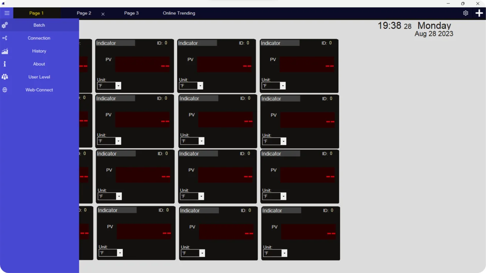
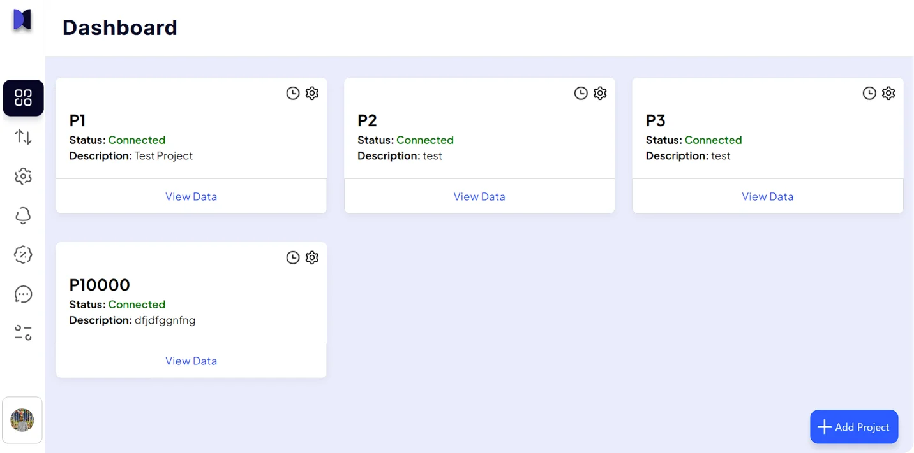
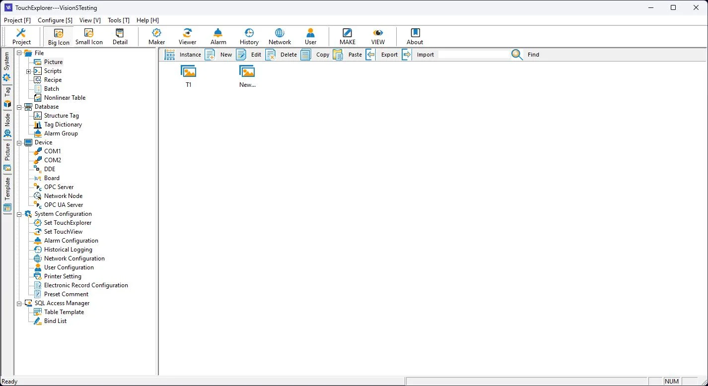
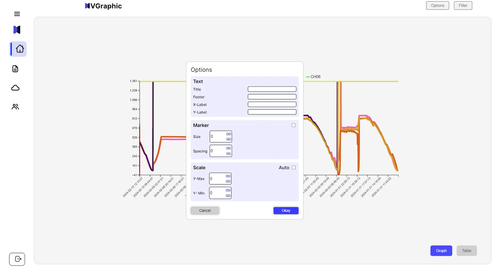

<!-- Markdown mirror of https://dicot.tech/products/. The HTML page remains the source of truth. -->
Product suite

# SCADA software for every size of plant.

Start with a single machine and a mini-SCADA, grow into a multi-line plant, or put remote sites on a phone. Every product shares the same tag model and reporting logic, so your team learns one system.

| Product | Best for | Tags | Deployment | Licence |
| --- | --- | --- | --- | --- |
| **[Vision C](/products/vision-c/)**  
Mini-SCADA & data logger | Machine builders, panel integrators and plant teams that need reliable logging and remote monitoring without a development project. | 100 | On-premise Windows | 2–20 years or perpetual |
| **[Vision Web](/products/vision-web/)**  
Cloud SCADA & IIoT platform | Teams that need remote monitoring, multi-site visibility and mobile alarms without running servers or a VPN. | 20,000 per project | Hosted by Dicot | Yearly subscription |
| **[Vision S](/products/vision-s/)**  
Enterprise SCADA | Pharma, process and large manufacturing sites that need audit trails, high tag counts and a configurable SCADA architecture. | 60,000 | On-premise Windows | Tag-based, runtime + development |
| **[Vision S Lite](/products/vision-s-lite/)** In development  
Lightweight enterprise SCADA | Machine builders and plant teams that need Vision S-style SCADA, but do not need the full protocol library or the full design environment. | Below Vision S | Vision S platform | Announced at launch |
| **[VGraphic](/products/vgraphic/)**  
Cloud report generator | Quality, maintenance and production teams that spend hours turning exported data into shift and management reports. | Not tag-based | Cloud | 1–10 years or offline lifetime |

01 · Mini-SCADA & data logger

## Vision C

Vision C is a Windows mini-SCADA and data logger for compact machines and single lines. It handles up to 100 tags, connects over Modbus TCP/IP, RTU, BCD and AIBUS, and pushes data to Vision Web in one click. Licences run from two years to perpetual.

Up to 100Modbus TCP/IP, RTU, BCD, AIBUSOn-premises, WindowsUnlimited

[Explore Vision C](/products/vision-c/) [Plans & licensing](/pricing/)

Vision C — product interface

02 · Cloud SCADA & IIoT platform

## Vision Web

Vision Web is Dicot's hosted cloud SCADA platform. It brings up to 20,000 tags per project into a browser, updates at 50–100 ms, keeps two years of history and sends alarms by SMS, email, WhatsApp and Telegram. Dicot hosts and maintains the platform; you log in and run the plant.

Up to 20,000 per projectHTTP, MQTT50–100 msManaged by Dicot

[Explore Vision Web](/products/vision-web/) [Plans & licensing](/pricing/)

Vision Web — product interface

03 · Enterprise SCADA

## Vision S

Vision S is Dicot's enterprise SCADA for large and regulated plants. It scales to 60,000 tags, speaks 4,000+ protocols including OPC UA and DA, keeps 21 CFR-ready audit trails and stores history in PostgreSQL. Runtime, development, client-server and web-client licences can be mixed to fit the architecture.

Up to 60,0004,000+, OPC UA and DA21 CFR-readyPostgreSQL

[Explore Vision S](/products/vision-s/) [Plans & licensing](/pricing/)

Vision S — product interface

04 · Lightweight enterprise SCADA

## Vision S LiteIn development

Vision S Lite is a lighter edition of Vision S, in development at Dicot. It keeps the Vision S software approach but uses a reduced protocol set and a smaller design library, for applications that need Vision S-style SCADA without the full footprint.

Vision S platformReduced set vs Vision SSmaller than Vision SCost-sensitive applications

[See what we can share](/products/vision-s-lite/) [Register interest](/contact/?interest=vision-s-lite)

In development **Vision S Lite**

Lighter Vision S platform · reduced protocol set · smaller design library

Vision S Lite — launch preview

05 · Cloud report generator

## VGraphic

VGraphic is a cloud report generator for industrial data. Upload or connect Excel, CSV, SQL and DAT files, filter by time or file, and export branded PDF tables and graphs from a desktop or mobile browser. There is nothing to install.

None, cloud-basedExcel, CSV, SQL, DATPDF tables and graphsDesktop and mobile

[Explore VGraphic](/products/vgraphic/) [Plans & licensing](/pricing/)

VGraphic — product interface

## Not sure which product fits?

Tell us the tag count, protocols and whether you need cloud or on-premise. We will point you to the smallest product that does the job.

[Book a demo](/contact/) [Talk to a dealer](/contact/#channel-partners)

---

Generated 2026-11-23 from https://dicot.tech/products/. Questions: sales@dicot.tech
