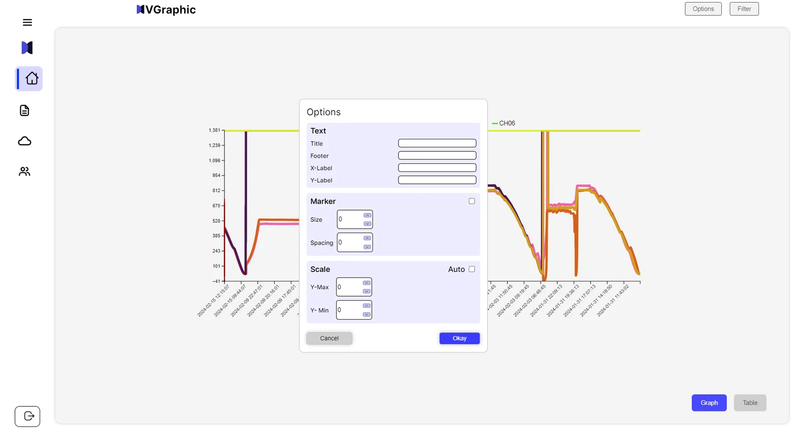

<!-- Markdown mirror of https://dicot.tech/products/vgraphic/. The HTML page remains the source of truth. -->
Cloud report generator

# VGraphic

Turn plant files into branded PDF reports from anywhere.

VGraphic is a cloud report generator for industrial data. Upload or connect Excel, CSV, SQL and DAT files, filter by time or file, and export branded PDF tables and graphs from a desktop or mobile browser. There is nothing to install.

[Book a demo](/contact/) [See plans](/pricing/)

Last updated November 2026

VGraphic — product interface

Key facts

## What VGraphic does.

### Best for

Quality, maintenance and production teams that spend hours turning exported data into shift and management reports.

<table class="spec-table"><tbody><tr><th>Installation</th><td>None, cloud-based</td></tr><tr><th>Input files</th><td>Excel, CSV, SQL, DAT</td></tr><tr><th>Output</th><td>PDF tables and graphs</td></tr><tr><th>Apps</th><td>Desktop and mobile</td></tr><tr><th>Filters</th><td>Time and file</td></tr><tr><th>Branding</th><td>Logo, header, footer</td></tr><tr><th>Storage</th><td>Cloud, expandable</td></tr><tr><th>Licence</th><td>1, 5 or 10 years; offline lifetime</td></tr></tbody></table>

Capabilities

## What you get on day one.

No add-on modules to buy before the product is useful. These are part of the platform.

01

### No installation

Open a browser, load the data and generate the report. Nothing to deploy on operator PCs.

02

### Works with what you already export

Excel, CSV, SQL and DAT files from PLCs, loggers and historians.

03

### Branded PDFs

Add your logo, header and footer so reports go out looking like your company made them.

04

### Graphs and tables

Export both views in one report, filtered by time range or source file.

05

### Access from the floor

Desktop and mobile apps let supervisors pull a shift report without returning to a cabin.

Plans & licensing

## Licence it the way your plant buys.

Cloud and offline editions are available. Prices are shared through authorised dealers.

[Request a quote](/contact/) [Find a dealer](/contact/#channel-partners)

| Edition | What it includes |
| --- | --- |
| **1-year cloud** | Cloud licence with report generation and storage. |
| **5-year cloud** | Longer cloud term for recurring reporting. |
| **10-year cloud** | For long-life plant and OEM programmes. |
| **Offline lifetime** | Perpetual offline licence for air-gapped sites. |
| **Extra storage** | Additional cloud storage per GB per year. |

Requirements

## What it runs on.

Modest hardware by industrial software standards. Check these before a pilot.

-   Modern browser for the cloud edition
-   Excel, CSV, SQL or DAT source files
-   Internet connection for cloud sync

FAQ

## VGraphic: questions buyers ask

What is VGraphic?

VGraphic is a report generator for industrial data. It converts Excel, CSV, SQL and DAT files into branded PDF reports with tables and graphs.

Do I need to install anything?

No for the cloud edition. The offline lifetime edition is available for sites that cannot use the cloud.

Can reports carry our logo?

Yes. Logo, header and footer are configurable per report.

How is VGraphic licensed?

Cloud licences run for 1, 5 or 10 years. An offline lifetime licence and extra cloud storage are also available.

Related

## Works with the rest of the suite.

[All products](/products/)

[

### Vision C

Mini-SCADA & data logger

Shop-floor SCADA that installs in minutes, not months.

Up to 100Modbus TCP/IP, RTU, BCD, AIBUS

](/products/vision-c/)[

### Vision Web

Cloud SCADA & IIoT platform

Your plant on any screen, with alarms where your team already is.

Up to 20,000 per projectHTTP, MQTT

](/products/vision-web/)[

### Vision S

Enterprise SCADA

Full SCADA for regulated, high-tag-count plants.

Up to 60,0004,000+, OPC UA and DA

](/products/vision-s/)

## See VGraphic on your data.

A 30-minute demo with your tags, your protocols and your questions. No slide deck.

[Book a demo](/contact/) [Talk to a dealer](/contact/#channel-partners)

---

Generated 2026-11-20 from https://dicot.tech/products/vgraphic/. Questions: sales@dicot.tech
