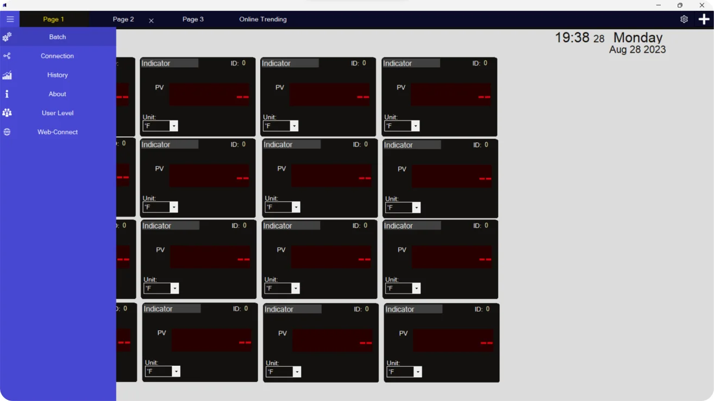

<!-- Markdown mirror of https://dicot.tech/products/vision-c/. The HTML page remains the source of truth. -->
Mini-SCADA & data logger

# Vision C

Shop-floor SCADA that installs in minutes, not months.

Vision C is a Windows mini-SCADA and data logger for compact machines and single lines. It handles up to 100 tags, connects over Modbus TCP/IP, RTU, BCD and AIBUS, and pushes data to Vision Web in one click. Licences run from two years to perpetual.

[Book a demo](/contact/) [See plans](/pricing/)

Last updated November 2026

Vision C — product interface

Key facts

## What Vision C does.

### Best for

Machine builders, panel integrators and plant teams that need reliable logging and remote monitoring without a development project.

<table class="spec-table"><tbody><tr><th>Tags</th><td>Up to 100</td></tr><tr><th>Protocols</th><td>Modbus TCP/IP, RTU, BCD, AIBUS</td></tr><tr><th>Deployment</th><td>On-premises, Windows</td></tr><tr><th>User levels</th><td>Unlimited</td></tr><tr><th>Historical data</th><td>File-based, exportable</td></tr><tr><th>Trends</th><td>Last 1 hour, live</td></tr><tr><th>Recipes</th><td>PID, up to 100 steps</td></tr><tr><th>Languages</th><td>8</td></tr><tr><th>Security</th><td>2-layer</td></tr><tr><th>Install size</th><td>~10 MB</td></tr><tr><th>OS</th><td>Windows 8 or later</td></tr><tr><th>Licence</th><td>2, 5, 10, 20 years or perpetual</td></tr></tbody></table>

Capabilities

## What you get on day one.

No add-on modules to buy before the product is useful. These are part of the platform.

01

### Zero development time

Install, map your tags and start logging the same day. No screens to code, no integration project.

02

### One-click Vision Web link

Send live and historical data to the cloud without a gateway script or a second configuration.

03

### Batch recording

Record multiple batches at the same time with batch-wise reports for traceability.

04

### PID recipes

Store and recall up to 100-step recipes for repeatable process changes.

05

### Reports your team can read

Print or export PDF reports with your logo, watermark and header.

06

### Runs on modest hardware

About 10 MB installed, Windows 8 or later and 4 GB of RAM is enough.

Plans & licensing

## Licence it the way your plant buys.

Prices are shared through our authorised dealer network. Request a quote and we will route it to the right partner.

[Request a quote](/contact/) [Find a dealer](/contact/#channel-partners)

| Edition | What it includes |
| --- | --- |
| **2-year licence** | Full licence, unlimited tags within the 100-tag limit. |
| **5-year licence** | Same feature set with a longer support window. |
| **10-year licence** | For deployments with a long plant lifecycle. |
| **20-year licence** | Long-horizon licence for OEM and infrastructure projects. |
| **Perpetual licence** | Perpetual use without future software updates. |

Requirements

## What it runs on.

Modest hardware by industrial software standards. Check these before a pilot.

-   Windows 8 or later
-   4 GB RAM or more
-   Adobe PDF Reader for reports
-   Ethernet or serial port for device connectivity

FAQ

## Vision C: questions buyers ask

What is Vision C?

Vision C is a mini-SCADA and data-logging application for Windows. It reads tags from PLCs and devices, shows live values and trends, stores history, records batches and generates reports. It supports up to 100 tags.

Which protocols does Vision C support?

Modbus TCP/IP, Modbus RTU, BCD and AIBUS, across multiple ports.

Can Vision C send data to the cloud?

Yes. A one-click connection forwards data to Vision Web, Dicot's hosted SCADA platform, for remote monitoring and alerts.

How is Vision C licensed?

As a time-based licence of 2, 5, 10 or 20 years, or perpetual without future updates. Pricing is provided by authorised dealers.

Do I need a developer to set it up?

No. Configuration is done through the application. Most customers are logging data on the first day.

Related

## Works with the rest of the suite.

[All products](/products/)

[

### Vision Web

Cloud SCADA & IIoT platform

Your plant on any screen, with alarms where your team already is.

Up to 20,000 per projectHTTP, MQTT

](/products/vision-web/)[

### Vision S

Enterprise SCADA

Full SCADA for regulated, high-tag-count plants.

Up to 60,0004,000+, OPC UA and DA

](/products/vision-s/)[

### Vision S Lite

Lightweight enterprise SCADA

The Vision S platform, sized for cost-sensitive plants.

Vision S platformReduced set vs Vision S

](/products/vision-s-lite/)

## See Vision C on your data.

A 30-minute demo with your tags, your protocols and your questions. No slide deck.

[Book a demo](/contact/) [Talk to a dealer](/contact/#channel-partners)

---

Generated 2026-11-23 from https://dicot.tech/products/vision-c/. Questions: sales@dicot.tech
