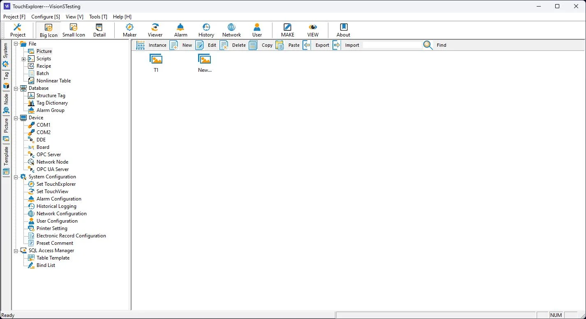

<!-- Markdown mirror of https://dicot.tech/products/vision-s/. The HTML page remains the source of truth. -->
Enterprise SCADA

# Vision S

Full SCADA for regulated, high-tag-count plants.

Vision S is Dicot's enterprise SCADA for large and regulated plants. It scales to 60,000 tags, speaks 4,000+ protocols including OPC UA and DA, keeps 21 CFR-ready audit trails and stores history in PostgreSQL. Runtime, development, client-server and web-client licences can be mixed to fit the architecture.

[Book a demo](/contact/) [See plans](/pricing/)

Last updated November 2026

Vision S — product interface

Key facts

## What Vision S does.

### Best for

Pharma, process and large manufacturing sites that need audit trails, high tag counts and a configurable SCADA architecture.

<table class="spec-table"><tbody><tr><th>Tags</th><td>Up to 60,000</td></tr><tr><th>Protocols</th><td>4,000+, OPC UA and DA</td></tr><tr><th>Audit trails</th><td>21 CFR-ready</td></tr><tr><th>Historical database</th><td>PostgreSQL</td></tr><tr><th>Scripting</th><td>C</td></tr><tr><th>User levels</th><td>Unlimited</td></tr><tr><th>Recipes</th><td>Unlimited</td></tr><tr><th>Batches</th><td>Multiple simultaneous</td></tr><tr><th>Reports</th><td>Print and PDF, fully customisable</td></tr><tr><th>Extras</th><td>E-signature, OPC UA server, multi-monitor</td></tr><tr><th>Licence</th><td>Tag-based, runtime and development</td></tr></tbody></table>

Capabilities

## What you get on day one.

No add-on modules to buy before the product is useful. These are part of the platform.

01

### Audit trails that stand up

21 CFR-ready trails, electronic signatures and user-level control for regulated manufacturing.

02

### 4,000+ device protocols

Connect mixed PLCs, drives and legacy equipment through OPC UA, OPC DA and native drivers.

03

### PostgreSQL history

Plant data lands in a standard database, so your BI and reporting tools can query it directly.

04

### C scripting

Write custom logic where configuration stops being enough, without leaving the platform.

05

### Architecture that fits

Mix development, runtime, client-server and web-client licences as the plant grows.

06

### Built for the control room

Multi-monitor layouts, alarms and batch views for operators who live in the system all shift.

Plans & licensing

## Licence it the way your plant buys.

Tag-based licensing with separate development and runtime editions. Prices are shared through authorised dealers.

[Request a quote](/contact/) [Find a dealer](/contact/#channel-partners)

| Edition | What it includes |
| --- | --- |
| **Development licence** | For building and testing projects. Not for production deployment. |
| **Runtime licence** | For live deployment on the plant floor, sized by tags. |
| **Client/Server licence** | For distributed architectures without an I/O licence included. |
| **Web Client licence** | Browser-based remote operation, sized by concurrent users. |
| **Accessories** | Electronic signature and OPC UA server add-ons. |
| **Enterprise scope** | Multi-site and 60,000-tag deployments scoped with our team. |

Requirements

## What it runs on.

Modest hardware by industrial software standards. Check these before a pilot.

-   Windows 7 or Windows 10
-   Pentium 4, 1 GHz or higher
-   4 GB RAM recommended (1 GB minimum)
-   PostgreSQL for historical logging

FAQ

## Vision S: questions buyers ask

What is Vision S?

Vision S is an enterprise SCADA platform for Windows. It collects data from PLCs and devices, provides operator screens, alarms, trends, reports, recipes and batch recording, and scales to 60,000 tags.

Does Vision S support 21 CFR Part 11 requirements?

Vision S provides 21 CFR-ready audit trails, electronic signatures and user-level access control. Validation and compliance remain the responsibility of the regulated site.

Which protocols are supported?

More than 4,000 drivers, including OPC UA and OPC DA, with multi-port connectivity.

Can I develop and deploy with different licences?

Yes. Development, runtime, client-server and web-client licences are separate, and can be combined.

Where is historical data stored?

In PostgreSQL, with options for third-party integration.

Related

## Works with the rest of the suite.

[All products](/products/)

[

### Vision C

Mini-SCADA & data logger

Shop-floor SCADA that installs in minutes, not months.

Up to 100Modbus TCP/IP, RTU, BCD, AIBUS

](/products/vision-c/)[

### Vision Web

Cloud SCADA & IIoT platform

Your plant on any screen, with alarms where your team already is.

Up to 20,000 per projectHTTP, MQTT

](/products/vision-web/)[

### Vision S Lite

Lightweight enterprise SCADA

The Vision S platform, sized for cost-sensitive plants.

Vision S platformReduced set vs Vision S

](/products/vision-s-lite/)

## See Vision S on your data.

A 30-minute demo with your tags, your protocols and your questions. No slide deck.

[Book a demo](/contact/) [Talk to a dealer](/contact/#channel-partners)

---

Generated 2026-11-20 from https://dicot.tech/products/vision-s/. Questions: sales@dicot.tech
