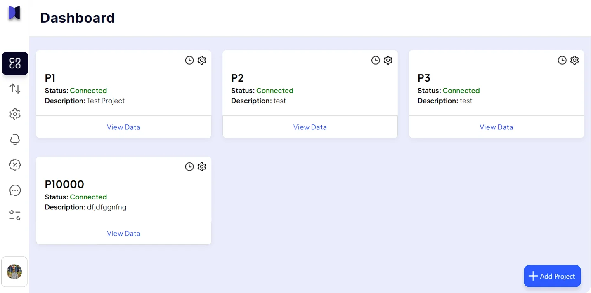

<!-- Markdown mirror of https://dicot.tech/products/vision-web/. The HTML page remains the source of truth. -->
Cloud SCADA & IIoT platform

# Vision Web

Your plant on any screen, with alarms where your team already is.

Vision Web is Dicot's hosted cloud SCADA platform. It brings up to 20,000 tags per project into a browser, updates at 50–100 ms, keeps two years of history and sends alarms by SMS, email, WhatsApp and Telegram. Dicot hosts and maintains the platform; you log in and run the plant.

[Book a demo](/contact/) [See plans](/pricing/)

Last updated November 2026

Vision Web — product interface

Key facts

## What Vision Web does.

### Best for

Teams that need remote monitoring, multi-site visibility and mobile alarms without running servers or a VPN.

<table class="spec-table"><tbody><tr><th>Tags</th><td>Up to 20,000 per project</td></tr><tr><th>Protocols</th><td>HTTP, MQTT</td></tr><tr><th>Update latency</th><td>50–100 ms</td></tr><tr><th>Hosting</th><td>Managed by Dicot</td></tr><tr><th>Historical data</th><td>NoSQL, 2-year retention</td></tr><tr><th>Alarms</th><td>SMS, email, WhatsApp, Telegram</td></tr><tr><th>Security</th><td>3-layer encryption, 2FA</td></tr><tr><th>Users</th><td>Unlimited user levels</td></tr><tr><th>Reports</th><td>Print and PDF, automatable</td></tr><tr><th>Licence</th><td>Yearly subscription</td></tr></tbody></table>

Capabilities

## What you get on day one.

No add-on modules to buy before the product is useful. These are part of the platform.

01

### No server to maintain

Dicot hosts, patches and backs up the platform. Your team opens a browser or the mobile app.

02

### Alarms on the channels you use

Route different triggers to SMS, email, WhatsApp or Telegram so the right person hears about it.

03

### Derived channels

Calculate efficiency, totals and ratios in the platform instead of adding logic to every PLC.

04

### Two-factor authentication

Protect operator access with a second factor, alongside per-user passwords and roles.

05

### Data forwarding

Push selected data to your own systems instead of locking it inside a dashboard.

06

### Mobile-first monitoring

Android and Windows clients keep the plant visible when nobody is at a desk.

Plans & licensing

## Licence it the way your plant buys.

Yearly subscription, quoted through authorised dealers. User add-ons apply after the included user allowance.

[Request a quote](/contact/) [Find a dealer](/contact/#channel-partners)

| Edition | What it includes |
| --- | --- |
| **10 tags** | Single small asset or a pilot project. |
| **50 tags** | One machine or a compact production line. |
| **500 tags** | A full line or a small plant. |
| **5,000 tags** | Multi-line or multi-site monitoring. |
| **Enterprise** | Above 5,000 tags, scoped with our team. |
| **Add-ons** | Additional users, SMS credits and WhatsApp alerts. |

Requirements

## What it runs on.

Modest hardware by industrial software standards. Check these before a pilot.

-   Modern browser
-   Internet connection at the plant gateway
-   Android 8+ or Windows for the client apps
-   MQTT-capable gateway or Vision C for data collection

FAQ

## Vision Web: questions buyers ask

Is Vision Web hosted by Dicot?

Yes. Dicot hosts, maintains and backs up Vision Web. Customers do not need to provision cloud infrastructure or manage servers.

How fast does Vision Web update?

Typical latency is 50–100 ms on a stable connection.

How long is data retained?

Two years of historical data is retained in the platform's NoSQL store.

Which alarm channels are supported?

SMS, email, WhatsApp and Telegram, with different triggers and recipients per alarm.

Can I connect an existing PLC or Vision C installation?

Yes. Vision Web receives data over MQTT or HTTP, and Vision C can forward data with a one-click connection.

How is Vision Web priced?

As a yearly subscription by tag count, with add-ons for extra users, SMS and WhatsApp. Prices are shared through authorised dealers.

Related

## Works with the rest of the suite.

[All products](/products/)

[

### Vision C

Mini-SCADA & data logger

Shop-floor SCADA that installs in minutes, not months.

Up to 100Modbus TCP/IP, RTU, BCD, AIBUS

](/products/vision-c/)[

### Vision S

Enterprise SCADA

Full SCADA for regulated, high-tag-count plants.

Up to 60,0004,000+, OPC UA and DA

](/products/vision-s/)[

### Vision S Lite

Lightweight enterprise SCADA

The Vision S platform, sized for cost-sensitive plants.

Vision S platformReduced set vs Vision S

](/products/vision-s-lite/)

## See Vision Web on your data.

A 30-minute demo with your tags, your protocols and your questions. No slide deck.

[Book a demo](/contact/) [Talk to a dealer](/contact/#channel-partners)

---

Generated 2026-11-20 from https://dicot.tech/products/vision-web/. Questions: sales@dicot.tech
